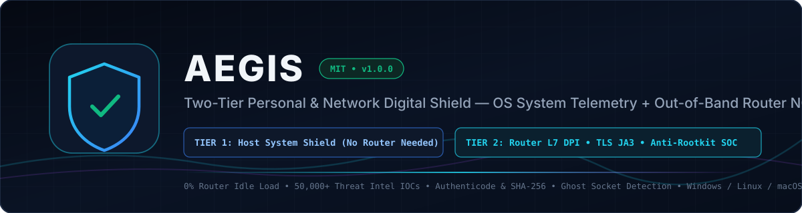
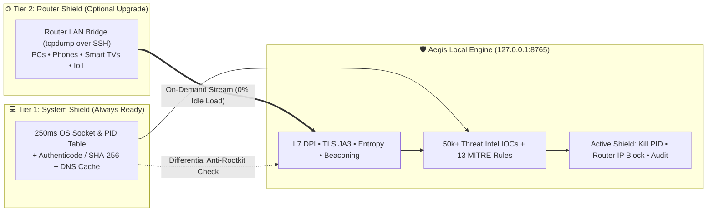

<p align="center">
  
</p>

<p align="center">
  <a href="LICENSE"></a>
  <a href="https://github.com/gen3space/AEGIS/actions"></a>
  <a href="docs/BUILD_GUIDE.md"></a>
  <a href="docs/ARCHITECTURE.md"></a>
  <a href="pyproject.toml"></a>
</p>

<p align="center">
  <a href="README.md"><strong>🇬🇧 English</strong></a> •
  <a href="README.ru.md"><strong>🇷🇺 Русская документация</strong></a> •
  <a href="docs/ROUTER_SETUP.md"><strong>🌐 Router Setup</strong></a> •
  <a href="docs/AI_ROUTER_PROMPT.md"><strong>🤖 AI Router Prompt</strong></a> •
  <a href="docs/BUILD_GUIDE.md"><strong>📦 Linux / Win / macOS Builds</strong></a> •
  <a href="docs/ARCHITECTURE.md"><strong>📐 Architecture</strong></a>
</p>

---

**Aegis** is a modern, local-first, MIT-licensed **Personal & Network Digital Shield**.

Most security tools force an awkward trade-off: host-based firewalls (`netstat`, Task Manager, EDRs) are **blind to kernel rootkits** and cannot see phones or IoT cameras on your Wi-Fi, while heavy router IDS suites (`Suricata`, `Zeek`) devour your home router's RAM and flash storage.

**Aegis solves both with a progressive Two-Tier Shield architecture:**

| Shield Tier | When It Runs | What You Get |
| :--- | :--- | :--- |
| **💻 Tier 1: Personal System Shield**<br>*(OS Level — No Router Needed)* | **Automatically out-of-the-box** on Windows, Linux, or macOS when no router is connected | Live `250 ms` OS kernel TCP/UDP socket-to-PID telemetry, `Authenticode` / `codesign` digital signature verification, `SHA-256` binary hashing, zero-driver OS DNS cache attribution, real-time NIC bandwidth oscilloscope, 50,000+ Threat Intel IOCs, **Silence Mode**, and rogue PID termination. |
| **🌐 Tier 2: Network Gateway Shield**<br>*(Router Out-of-Band Level)* | When connected to your **OpenWrt / Entware / Linux router** via passwordless SSH | **Everything in Tier 1 PLUS:** Whole-LAN visibility (smartphones, Smart TVs, Wi-Fi IoT *before* VPN/NAT), wire-speed L7 Deep Packet Inspection, **TLS `JA3` C2 fingerprinting**, **Out-of-Band `GHOST SOCKET` Anti-Rootkit detection**, Read-Only Router Security Audit, and 1-click **Network-Wide IP Blocking & IoT Quarantine** — with **`0% CPU / 0 MB RAM`** router load when paused! |

---

## ✨ Key Capabilities & How It Works



1. **Out-of-Band Anti-Rootkit (`GHOST SOCKET` / `AEGIS-001`):** In Tier 2, Aegis captures frames *outside* your PC on the physical router bridge and cross-checks them every `250 ms` against your OS kernel socket table. If a kernel or raw-socket rootkit hides its connection from Windows/Linux/macOS, the router catches its packets on the wire and raises an immediate **`CRITICAL: GHOST SOCKET`** alert.
2. **Pure-Python Wire-Speed L7 DPI & TLS `JA3`:** Decodes IPv4, IPv6, `802.1Q` VLANs, DNS/mDNS, TLS 1.0–1.3 `ClientHello` (`SNI`, `ALPN`, RFC 8701 GREASE-filtered `JA3` MD5 fingerprints), HTTP, QUIC (`HTTP/3`), WebRTC/STUN, WireGuard, SSH banners, BitTorrent/DHT, and `Stratum` crypto-mining RPC.
3. **50,000+ Live Threat Intelligence IOCs (Zero Router RAM):** Automatically syncs **Abuse.ch Feodo Tracker**, **IPsum L3+**, **CINS Army**, **Emerging Threats**, **Tor Exit Nodes**, **URLhaus Malware Domains**, and curated C2 `JA3` signatures (**Cobalt Strike, Meterpreter, Sliver, AsyncRAT, RedLine, Emotet, QakBot**). Stored strictly on your computer (`data/feeds/`).
4. **Silence Mode (`Idle-Watch`) & Behavioral Analytics:** Arm **Silence Mode** before stepping away from your desk — any unexpected data transfer triggers an instant alert. Statistical detectors catch low-jitter C2 beaconing ($\text{CV} \le 0.12$) and high-entropy DNS tunneling ($H \ge 3.85$).
5. **Active Containment & Forensics:** Terminate rogue host processes, block malicious external IPs or quarantine compromised IoT devices in router RAM (`nftables`/`iptables`), run a **Read-Only Router Hardening Audit (`A+`–`D`)**, and export **Wireshark `.pcap` captures** or **Markdown SOC Incident Reports**.
6. **100% Local & Private (`127.0.0.1`):** Zero cloud accounts, zero telemetry phoning home, bilingual UI (`EN` / `RU`).

---

## 🚀 Quick Start (30 Seconds)

### Option A: Standalone Native Binary (Windows / Linux / macOS)

Download the pre-built single-file binary from [**Releases**](https://github.com/gen3space/AEGIS/releases) (or build it in one command via [`docs/BUILD_GUIDE.md`](docs/BUILD_GUIDE.md)):

```bash
# Windows (PowerShell or double-click in Explorer — opens Tier 1 System Shield immediately!)
.\aegis-windows-x64.exe

# Linux / macOS
chmod +x ./aegis-linux-x64
./aegis-linux-x64 --open-browser
```

### Option B: Run from Python (`3.10+`)

```bash
git clone https://github.com/gen3space/AEGIS.git
cd aegis
pip install -e .

# 1. Start immediately in Tier 1 (System Shield) — no router needed!
aegis --open-browser

# 2. Or preview synthetic L7 DPI + JA3 + Ghost-Socket Rootkit simulation:
aegis --demo --open-browser
```

Open **http://127.0.0.1:8765** in your browser.

---

## 🌐 Upgrade to Tier 2: Connect Your Router (+ AI Setup Assistant)

Already have **OpenWrt**, **GL.iNet**, **Keenetic (Entware)**, **Asuswrt-Merlin**, **Ubiquiti**, or a **Linux Gateway**?

### 1. Quick OpenWrt Bootstrap (Adds ~150 KB `tcpdump-mini`, Zero Daemons)

```bash
# Authorize your SSH Ed25519 key once, then install tcpdump-mini:
scp router/openwrt_aegis_setup.sh root@192.168.1.1:/tmp/
ssh root@192.168.1.1 "sh /tmp/openwrt_aegis_setup.sh"

# Launch Aegis in Tier 2 Whole-Network Shield mode:
aegis --router 192.168.1.1 --iface br-lan --open-browser
```

*(See [`examples/`](examples/) and [`docs/ROUTER_SETUP.md`](docs/ROUTER_SETUP.md) for Keenetic Entware port `222` / `br0`, ASUS-Merlin, and Linux gateways.)*

### 2. 🤖 Configure *Any* Router with an AI Assistant

Every router UI is different. Click **`🌐 Router + AI`** directly inside the Aegis Web Console (or open [**`docs/AI_ROUTER_PROMPT.md`**](docs/AI_ROUTER_PROMPT.md)) to copy a ready-made prompt tailored to your exact router model for ChatGPT, Claude, Gemini, or DeepSeek!

---

## 🛡️ Built-In MITRE ATT&CK Detection Rules

| Rule ID | Severity | MITRE ATT&CK | Detection Logic |
| :--- | :--- | :--- | :--- |
| `AEGIS-001` | **CRITICAL** | `T1014` (Rootkit) | **Ghost Socket:** Router captures outbound host packets invisible to the host OS kernel socket table |
| `AEGIS-002` | **CRITICAL** | `T1071` (C2) | Destination IP matches active Botnet C2 / Compromised Host feeds (Feodo, IPsum L3+, CINS, ET) |
| `AEGIS-003` | **CRITICAL** | `T1573` | TLS `ClientHello` `JA3` matches known C2 implants (Cobalt Strike, Sliver, Meterpreter, AsyncRAT) |
| `AEGIS-004` | **CRITICAL** | `T1566` | DNS query, TLS SNI, or HTTP Host matches active URLhaus malware domain |
| `AEGIS-005` | **HIGH** | `T1496` | `Stratum` JSON-RPC payload or cryptocurrency mining pool connection |
| `AEGIS-006` | **HIGH** | `T1219` | Remote access / reverse tunnel activity (`AnyDesk`, `TeamViewer`, `RustDesk`, `Ngrok`, `RDP`, `VNC`) |
| `AEGIS-007` | **HIGH** | `T1071.004` | High-entropy long subdomain indicative of DNS tunneling / data exfiltration ($H \ge 3.85$) |
| `AEGIS-008` | **HIGH** | `T1090.003` | Outbound connection to a Tor exit/relay node |
| `AEGIS-009` | **HIGH** | `T1071` | Low-jitter periodic C2 beaconing ($\text{CV} \le 0.12$) |
| `AEGIS-010` | **HIGH** | `T1218` / `T1204` | External session initiated by a `LOLBin` interpreter or unsigned binary in `Temp`/`Downloads` |
| `AEGIS-011` | **HIGH** | `IDLE-WATCH` | Unplanned network transfer while **Silence Mode** is armed |
| `AEGIS-012` | **MEDIUM** | `T1071` | Direct-to-IP session initiated without prior DNS resolution or TLS SNI |
| `AEGIS-013` | **MEDIUM** | `T1048` | Connection to classic backdoor / reverse-shell / RAT TCP/UDP port |

---

## 📦 Building for Linux, Windows & macOS

Full instructions in [**`docs/BUILD_GUIDE.md`**](docs/BUILD_GUIDE.md):

```bash
# Windows (.exe)
powershell -ExecutionPolicy Bypass -File scripts/build_windows.ps1

# Linux & macOS (native single-file binary)
bash scripts/build_unix.sh
```

---

## 🧪 Development & Hygiene Verification

```bash
pip install -e ".[dev]"
python scripts/verify_clean_repo.py   # Zero-leak privacy & secret hygiene scanner
ruff check aegis tests scripts        # Linter
pytest -v                             # Unit & API test suite
```

---

## 📄 License

Released under the [**MIT License**](LICENSE). Free for personal, academic, and commercial security operations.
