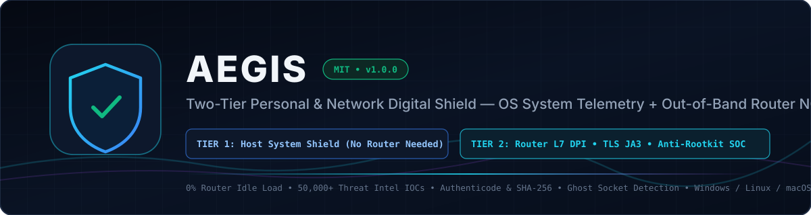

<p align="center">
  
</p>

<p align="center">
  <a href="LICENSE"></a>
  <a href="https://github.com/gen3space/AEGIS/actions"></a>
  <a href="docs/BUILD_GUIDE.md"></a>
  <a href="docs/ARCHITECTURE.md"></a>
</p>

<p align="center">
  <a href="README.md"><strong>🇬🇧 English README</strong></a> •
  <a href="README.ru.md"><strong>🇷🇺 Русский</strong></a> •
  <a href="docs/ROUTER_SETUP.md"><strong>🌐 Подключение роутера</strong></a> •
  <a href="docs/AI_ROUTER_PROMPT.md"><strong>🤖 ИИ-промпт для роутера</strong></a> •
  <a href="docs/BUILD_GUIDE.md"><strong>📦 Сборка (Linux / Win / Mac)</strong></a> •
  <a href="docs/ARCHITECTURE.md"><strong>📐 Архитектура</strong></a>
</p>

---

**Aegis** — это открытый (`MIT`) **двухуровневый цифровой щит** для персонального компьютера и всей домашней или офисной сети.

Обычные фаерволы и утилиты (`Task Manager`, `netstat`, локальные антивирусы) **слепы перед руткитами уровня ядра** и не видят трафик смартфонов, телевизоров и умных камер в вашей Wi-Fi сети. С другой стороны, установка тяжёлых IDS-систем (`Suricata`, `Zeek`) прямо на домашний роутер быстро забивает его память и нагружает процессор.

**Aegis решает обе задачи за счёт двухуровневой архитектуры:**

| Уровень защиты | Когда включается | Что контролирует |
| :--- | :--- | :--- |
| **💻 Уровень 1: Персональный системный щит**<br>*(На уровне ОС — роутер не нужен)* | **Сразу при запуске** на Windows, Linux или macOS, если роутер не подключён | Живой опрос ядерной таблицы TCP/UDP сокетов каждые `250 мс`, привязка к процессам (`PID`/`PPID`), проверка цифровых подписей (`Authenticode` / `codesign`) и хэшей `SHA-256`, чтение DNS-кэша ОС без драйверов, осциллограф скорости сетевой карты, проверка по 50 000+ базам угроз, **Режим тишины** и завершение подозрительных процессов. |
| **🌐 Уровень 2: Сетевой щит роутера**<br>*(Уровень выше — контроль над всей сетью)* | При подключении к роутеру (**OpenWrt, Keenetic Entware, GL.iNet, ASUS-Merlin, Linux**) по SSH-ключу | **Всё из Уровня 1 ПЛЮС:** контроль *всех* устройств в сети (телефоны, ТВ, IoT-камеры до VPN и NAT), глубокий разбор протоколов **L7 DPI**, криптографические отпечатки **TLS `JA3`**, внешний анти-руткит перехват **`GHOST SOCKET`**, аудит защищённости роутера и **блокировка атакующих IP / карантин IoT-устройств** на фаерволе роутера при **`0% нагрузки`** в паузе! |

---

## 🔍 Подробно о возможностях и принципе работы

1. **Внешний перехват руткитов (`GHOST SOCKET` / `AEGIS-001`):** На Уровне 2 пакеты снимаются *снаружи* компьютера — прямо на сетевом мосту роутера (`br-lan` / `br0`) — и каждые `250 мс` сверяются с таблицей сокетов ядра вашей ОС. Если руткит скрыл свой процесс и открытый порт от самой Windows/Linux/macOS, роутер всё равно видит его пакеты на проводе и мгновенно поднимает критическую тревогу **`GHOST SOCKET`**.
2. **Чистый L7 DPI и TLS `JA3`:** Потоковый разбор IPv4/IPv6/VLAN, Passive DNS/mDNS, TLS 1.0–1.3 `ClientHello` (`SNI`, `ALPN`, расчёт `JA3` с фильтрацией RFC 8701 GREASE), HTTP, QUIC (`HTTP/3`), WebRTC/STUN, WireGuard, SSH, BitTorrent/DHT и крипто-майнинга `Stratum`.
3. **50 000+ индикаторов угроз (0 байт на роутере):** Автоматическая загрузка и сверка с **Abuse.ch Feodo Tracker**, **IPsum L3+**, **CINS Army**, **Emerging Threats**, **Tor Exit Nodes**, **URLhaus** и отпечатками C2-фреймворков (**Cobalt Strike, Meterpreter, Sliver, AsyncRAT, RedLine, Emotet, QakBot**). Все базы хранятся на ПК (`data/feeds/`).
4. **Режим тишины (`Silence Mode`) и поведенческий анализ:** Включите режим одной кнопкой и отойдите от ПК — любая несанкционированная передача данных сразу вызовет тревогу. Статистический движок ловит ритмичные маяки C2 ($\text{CV} \le 0.12$) и скрытые DNS-туннели (энтропия Шеннона $H \ge 3.85$).
5. **Активная защита и управление сетью:** Завершайте подозрительные процессы ОС, блокируйте внешние IP ботнетов для всей домашней сети или изолируйте взломанные умные устройства временными RAM-правилами (`nftables` / `iptables`) на роутере, проводите **аудит безопасности периметра роутера (`A+`–`D`)**, выгружайте **`.pcap` для Wireshark** и **Markdown-отчёты ИБ**.
6. **100% локально и приватно (`127.0.0.1`):** Никаких облачных аккаунтов и сторонней телеметрии. Мгновенное переключение языка `RU` / `EN` в шапке консоли.

---

## 🚀 Быстрый старт

### Вариант 1: Готовый бинарный файл (без установки Python)

Скачайте файл под свою ОС в разделе [**Releases**](https://github.com/gen3space/AEGIS/releases) (или соберите за 1 команду по гайду [`docs/BUILD_GUIDE.md`](docs/BUILD_GUIDE.md)):

```bash
# Windows: просто запустите двойным кликом aegis-windows-x64.exe
# Консоль автоматически откроется на http://127.0.0.1:8765 в режиме Системного щита (Уровень 1)!

# Linux / macOS:
chmod +x ./aegis-linux-x64
./aegis-linux-x64 --open-browser
```

### Вариант 2: Запуск из исходников (`Python 3.10+`)

```bash
git clone https://github.com/gen3space/AEGIS.git
cd aegis
pip install -e .

# 1. Запуск Системного щита (Уровень 1 — роутер не требуется):
aegis --lang ru --open-browser

# 2. Или демонстрация перехвата руткита Ghost Socket и L7 DPI:
aegis --demo --lang ru --open-browser
```

---

## 🌐 Подключение своего роутера (Уровень 2) + ИИ-помощник

### 1. Быстрое подключение OpenWrt / GL.iNet (~150 КБ `tcpdump-mini`)

```bash
# После добавления вашего SSH-ключа Ed25519 установите лёгкий tcpdump-mini:
scp router/openwrt_aegis_setup.sh root@192.168.1.1:/tmp/
ssh root@192.168.1.1 "sh /tmp/openwrt_aegis_setup.sh"

# Запуск Aegis на Уровне 2 (контроль всей сети + Анти-Руткит):
aegis --router 192.168.1.1 --iface br-lan --lang ru --open-browser
```

Готовые примеры конфигураций для **OpenWrt**, **Keenetic (Entware, порт 222, мост `br0`)**, **ASUS-Merlin** и **Linux-шлюзов** лежат в папке [`examples/`](examples/) и подробно разобраны в [`docs/ROUTER_SETUP.md`](docs/ROUTER_SETUP.md).

### 2. 🤖 Готовый ИИ-промпт для настройки любого роутера

Не знаете, как включить SSH-ключ и `tcpdump` именно на вашей модели роутера?
Нажмите кнопку **`🌐 Роутер + ИИ`** прямо в веб-интерфейсе Aegis (или откройте [**`docs/AI_ROUTER_PROMPT.md`**](docs/AI_ROUTER_PROMPT.md)), впишите модель роутера и скопируйте готовый промпт в ChatGPT, Claude, Gemini или DeepSeek — ИИ выдаст пошаговые команды конкретно под вашу прошивку!

---

## 📦 Сборка под Windows, Linux и macOS

Подробное руководство по сборке однофайловых бинарников (`PyInstaller`) и запуску в `Docker` — в [**`docs/BUILD_GUIDE.md`**](docs/BUILD_GUIDE.md):

```bash
# Сборка автономного .exe на Windows:
powershell -ExecutionPolicy Bypass -File scripts/build_windows.ps1

# Сборка автономного бинарника на Linux или macOS:
bash scripts/build_unix.sh
```

---

## 📄 Лицензия

Проект распространяется под свободной открытой лицензией [**MIT**](LICENSE).
