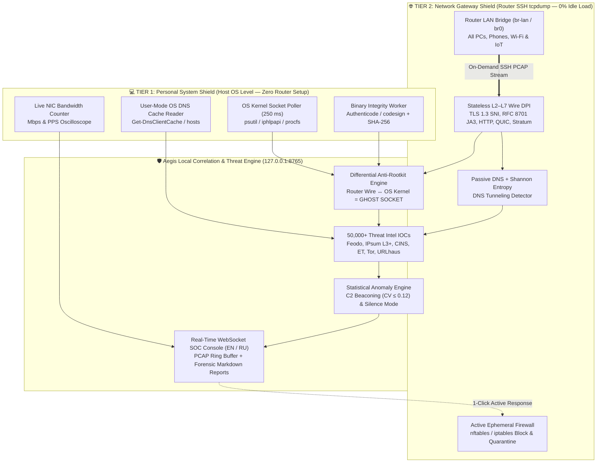

# 📐 Aegis Architecture & Detection Internals

Aegis is engineered around a **Two-Tier Progressive Defense Model**: it delivers immediate host-level protection on any operating system out of the box (**Tier 1**), and seamlessly scales into a zero-router-load network-wide NGFW & Out-of-Band Anti-Rootkit SOC when paired with a router (**Tier 2**).

---

## 1. Tier 1: Personal System Shield (`mode = "system"`)

When launched without a router configured, Aegis never shows an empty screen or connection error:
1. **250 ms Kernel Socket Attribution:** Polls active `AF_INET` / `AF_INET6` TCP and UDP endpoints, mapping each socket `(proto, local_ip, local_port, remote_ip, remote_port)` to `PID`, `PPID` (parent process), executable path, and OS account.
2. **Asynchronous Cryptographic Verification:** Hashes every active network binary (`SHA-256`) and validates publisher signatures (`Get-AuthenticodeSignature` on Windows, `codesign -dv` on macOS, FHS package-root verification on Linux), caching results in `data/sig_cache.json`.
3. **Zero-Driver OS DNS Cache Attribution:** Maps remote IPs back to queried domain names in user-mode without requiring kernel capture drivers (`Npcap` / `WinPcap`) by polling the OS DNS Resolver Cache.
4. **Live NIC Oscilloscope & IOC Matching:** Tracks real interface throughput deltas and evaluates every connection against all 50,000+ Threat Intelligence indicators, `LOLBin` rules, suspicious ports, periodic beaconing, and `Silence Mode`.

---

## 2. Tier 2: Out-of-Band Differential Anti-Rootkit (`mode = "router"`)

Host-only security tools share a fundamental architectural blind spot: **if a kernel-mode implant (WFP/NDIS callout driver, DKOM hook, eBPF/netlink filter) or userland API hook compromises the OS, it hides its processes and sockets from the OS itself.**

Aegis defeats this blind spot by introducing an **independent external observer**:
1. **External Wire Vantage Point:** Streams raw Ethernet frames from the router's LAN bridge (`tcpdump -i br-lan -nn -U -s 1514 -w -`) over SSH (`BatchMode=yes`). A BPF filter automatically excludes the SSH stream itself to prevent feedback loops.
2. **Differential Verification (`AEGIS-001 GHOST SOCKET`):** Before declaring a hidden rootkit socket, Aegis enforces strict anti-false-positive gates:
   - Outbound direction originating from an IP owned by the local workstation (`c_ip in correlator.local_ips`).
   - Sustained flow of $\ge 3$ outbound packets over $\ge 700\text{ ms}$ (ignoring ephemeral housekeeping ports like DNS `53`, NTP `123`, mDNS `5353`, DHCP `67/68`).
   - A `25 s` closed-port grace cache to absorb SSH transit jitter on short-lived connections.
   - An **immediate synchronous kernel re-poll** (`correlator.poll_sync()`) confirming the `(proto, src_port)` is genuinely absent from the OS kernel table.

---

## 3. Wire-Speed Pure-Python L7 DPI & TLS `JA3`

`aegis/dpi_engine.py` decodes packet headers in memory with zero C extensions:
- **L2 / L3 / L4:** Ethernet II, single/double `802.1Q` / `802.1ad` VLAN tags, IPv4, IPv6, TCP, UDP, ICMP/ICMPv6.
- **TLS 1.0–1.3 `ClientHello`:** Extracts `SNI`, `ALPN`, negotiated version via `supported_versions` (`0x002b`), and computes standard **TLS `JA3` MD5 fingerprints** while stripping all 16 **RFC 8701 GREASE** values (`0x0a0a`..`0xfafa`).
- **DNS Tunneling Entropy:** Computes Shannon entropy $H(X) = -\sum p(x_i)\log_2 p(x_i)$ across multi-label subdomains; queries $> 62$ chars with label length $\ge 36$ and $H(X) \ge 3.85$ trigger `AEGIS-007`.
- **Statistical C2 Beaconing:** Tracks inter-arrival intervals $\Delta t_i$ per `(src_ip, dst_ip, dst_port)` tuple; when $n \ge 6$, $\mu \ge 12\text{ s}$, and Coefficient of Variation $\text{CV} = \sigma / \mu \le 0.12$, triggers `AEGIS-009`.

---

## 4. Zero-Router-Overhead & Ephemeral Active Control

- **Idle Load = `0% CPU, 0 MB RAM`:** Pausing capture or closing Aegis terminates the SSH session, sending `SIGPIPE`/`EOF` to `tcpdump` on the router. All IOC databases (`data/feeds/`), GeoIP/BGP ASN caches, and the 15,000-packet `.pcap` ring buffer live strictly on the workstation.
- **RAM-Only Active Containment:** When blocking an external C2 IP or quarantining a compromised IoT device in Tier 2, `aegis/shield_control.py` creates an isolated `nftables` table (`inet aegis_shield`) or `iptables` chain (`AEGIS_SHIELD`) strictly in router RAM — never modifying `/etc/config/firewall` on flash storage, and cleanly reversible with one click (`Unblock All`) or a router reboot.
